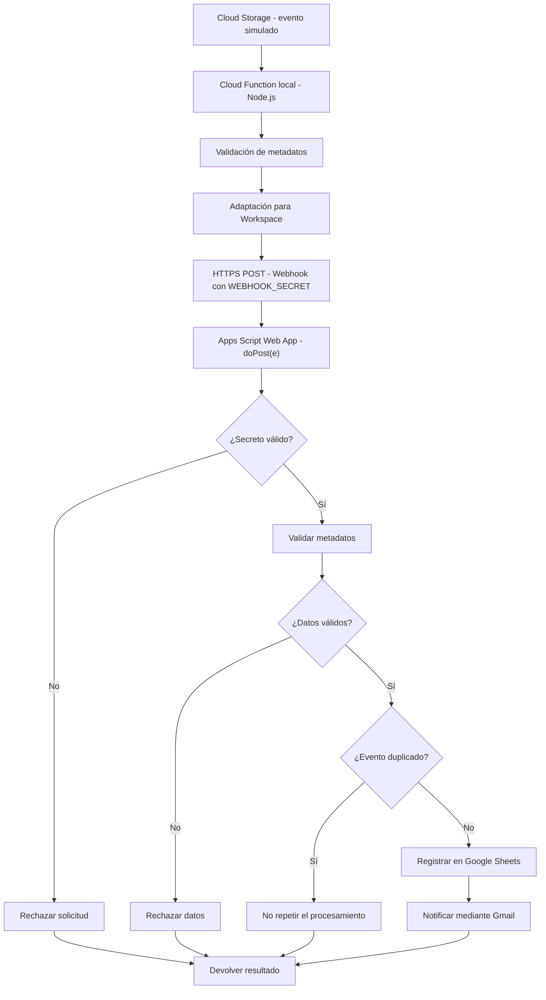

# Turing-IA | Día 3 — Integración GCP y Google Workspace

## 1. Descripción del proyecto

Este proyecto corresponde al Día 3 del periodo de prueba
técnica de Turing-IA, enfocado en la integración de servicios
de Google Cloud Platform (GCP) con Google Workspace.

Se desarrolló una Cloud Function en Node.js que recibe
eventos de carga de archivos, valida sus metadatos y los
envía mediante HTTPS a una aplicación web de Google Apps Script.

Apps Script verifica la autorización de la solicitud,
registra la información en Google Sheets y envía
notificaciones mediante Gmail.

**Alcance:** la Cloud Function se ejecutó localmente mediante
Functions Framework y los eventos de Cloud Storage se
simularon, debido a que no se habilitó facturación en GCP.

La integración HTTP con Apps Script, Sheets y Gmail sí
se comprobó utilizando servicios reales.

## 2. Objetivo

Implementar y validar un flujo de integración entre
GCP y Google Workspace que permita:

- Recibir eventos de carga de archivos.
- Extraer y validar metadatos.
- Transmitir información a una web app de Apps Script.
- Verificar la autorización de solicitudes.
- Registrar archivos en Google Sheets.
- Enviar notificaciones mediante Gmail.
- Evitar el procesamiento repetido de eventos.
- Registrar resultados y manejar errores.

## 3. Arquitectura



La arquitectura detallada se encuentra en
[docs/arquitectura.md](docs/arquitectura.md).

## 4. Tecnologías utilizadas

- Node.js 24.22.0
- JavaScript
- Google Cloud Functions Framework
- CloudEvents
- Google Apps Script
- Google Sheets
- Gmail
- HTTP/HTTPS
- PowerShell para simular eventos
- Node.js Test Runner (`node:test`)

## 5. Estructura del proyecto

```text
dia3-integracion/
├── apps-script/
│   └── Codigo.gs
├── cloud-function/
│   ├── index.js
│   ├── procesador.js
│   ├── adaptador.js
│   ├── cliente-webapp.js
│   ├── probar-webapp.js
│   ├── probar-webapp-autorizado.js
│   ├── probar-webapp-sin-autorizacion.js
│   ├── test/
│   ├── package.json
│   └── package-lock.json
├── docs/
│   ├── arquitectura.md
│   ├── seguridad.md
│   └── pruebas.md
├── evidencias/
├── tests/
├── .gitignore
└── README.md
```

Los directorios de credenciales privadas y dependencias
instaladas se excluyen del repositorio.

## 6. Componentes principales

### index.js

Punto de entrada de la Cloud Function.

Recibe eventos CloudEvent y coordina la validación,
adaptación y transmisión de metadatos.

### procesador.js

Extrae y valida:

- Identificador del evento.
- Nombre del archivo.
- Bucket.
- Tamaño.
- Tipo de archivo.

### adaptador.js

Transforma los metadatos al formato que espera Apps Script.

### cliente-webapp.js

Realiza solicitudes HTTPS POST a la web app.

Obtiene la URL y el secreto compartido desde variables
de entorno.

### Codigo.gs

Contiene la lógica de Apps Script para:

- Recibir solicitudes mediante `doPost(e)`.
- Verificar el secreto compartido.
- Validar metadatos.
- Detectar eventos duplicados.
- Registrar información en Google Sheets.
- Enviar notificaciones mediante Gmail.

## 7. Configuración del entorno

### Requisitos

- Node.js instalado.
- npm.
- PowerShell.
- Un proyecto de Google Apps Script.
- Una hoja de cálculo de Google Sheets.
- Permisos de Gmail para enviar notificaciones.

### 7.1 Instalar dependencias

Desde la carpeta del proyecto:

```powershell
cd .\cloud-function
npm ci
```

### 7.2 Configurar Apps Script

1. Crear o abrir el proyecto de Apps Script.
2. Incorporar el código de `apps-script/Codigo.gs`.
3. Configurar las propiedades que utiliza el script,
   incluida `WEBHOOK_SECRET`.
4. Configurar el destino de las notificaciones.
5. Autorizar los servicios de Google necesarios.
6. Desplegar temporalmente como aplicación web para
   realizar las pruebas de integración.

La aplicación web utilizada durante las pruebas se
ejecutó con los permisos de su propietaria.

**Importante:** el acceso público temporal no es una
configuración recomendada para producción.

### 7.3 Configurar variables de entorno

En PowerShell:

```powershell
$env:WORKSPACE_WEBAPP_URL = "URL_DE_TU_WEB_APP"
$env:WEBHOOK_SECRET = Read-Host "Introduce WEBHOOK_SECRET"
```

El secreto debe coincidir con el configurado
en las propiedades del proyecto de Apps Script.

No se deben guardar secretos en archivos públicos,
capturas de pantalla ni repositorios.

### 7.4 Iniciar la Cloud Function local

```powershell
npm start
```

Functions Framework inicia el servidor local,
que recibe CloudEvents en:

`http://localhost:8080/`

## 8. Simular un evento de Cloud Storage

Con la Cloud Function ejecutándose, abrir otra terminal
PowerShell y ejecutar:

```powershell
$headers = @{
    "ce-id" = "EVT-DEMO-001"
    "ce-source" = "//storage.googleapis.com/projects/_/buckets/bucket-pruebas"
    "ce-specversion" = "1.0"
    "ce-type" = "google.cloud.storage.object.v1.finalized"
    "ce-time" = "2026-10-26T21:30:00Z"
}

$body = @{
    name = "archivo_demo.pdf"
    bucket = "bucket-pruebas"
    size = "1024"
    contentType = "application/pdf"
} | ConvertTo-Json

Invoke-RestMethod `
    -Uri "http://localhost:8080/" `
    -Method Post `
    -Headers $headers `
    -ContentType "application/json" `
    -Body $body `
    -ErrorAction Stop
```

Esta simulación representa la carga de un archivo en
Cloud Storage sin utilizar un bucket real.

Si la solicitud es válida y el evento no existe,
Apps Script registra la información y envía
una notificación.

**Advertencia:** el ejemplo utiliza un identificador
nuevo y puede generar una fila y un correo reales.

## 9. Ejecutar pruebas automatizadas

Dentro de `cloud-function/`:

```powershell
npm test
```

### Resultado obtenido

| Componente | Pruebas aprobadas |
|---|---:|
| Procesamiento de metadatos | 5 |
| Adaptación para Workspace | 2 |
| Comunicación con la web app | 5 |
| **Total** | **12** |

Resultado de la última ejecución:

```text
tests 12
pass 12
fail 0
duration_ms 114.0941
```

Las pruebas de `cliente-webapp.js` simulan las respuestas
HTTP y no envían correos reales.

## 10. Pruebas de integración realizadas

### Solicitud no autorizada — EVT-024

Se envió una solicitud sin el secreto correcto.

Apps Script rechazó el procesamiento:

```json
{
  "procesado": false,
  "mensaje": "Solicitud no autorizada"
}
```

### Solicitud autorizada — EVT-025

Se envió una solicitud con el secreto correcto.

Se obtuvo una respuesta satisfactoria indicando
que el registro se guardó y la notificación se envió.

También se verificó que repetir EVT-025
fuera reconocido como duplicado.

### Integración completa — EVT-026

Se simuló un CloudEvent hacia la Cloud Function local.

La función transmitió los metadatos a Apps Script,
que registró el evento en Google Sheets y
envió la notificación mediante Gmail.

Se verificó visualmente:

- Registro EVT-026 en Google Sheets.
- Estado `Procesado`.
- Estado de notificación `Enviado`.
- Correo recibido en Gmail.

Al repetir EVT-026, la aplicación detectó
el evento duplicado.

Los resultados y tiempos se encuentran en
[docs/pruebas.md](docs/pruebas.md).

## 11. Seguridad

Se implementaron las siguientes medidas:

- Validación de metadatos en Node.js.
- Validación adicional en Apps Script.
- Autorización mediante secreto compartido.
- Comunicación mediante HTTPS hacia Apps Script.
- Prevención de registros duplicados.
- Manejo de errores y registros de ejecución.
- Exclusión de archivos privados mediante `.gitignore`.

El secreto compartido es un control básico
de autorización para el prototipo.

No se implementó OAuth 2.0 ni firma digital
en el webhook definitivo.

Los mecanismos, limitaciones y mejoras propuestas
se detallan en [docs/seguridad.md](docs/seguridad.md).

## 12. Incidencias y soluciones

| Incidencia | Solución |
|---|---|
| Facturación requerida para desplegar GCP | Uso de Functions Framework local |
| Web app privada inaccesible desde Node.js | Despliegue temporal con verificación de secreto |
| Secreto inicialmente incorrecto | Corrección de configuración |
| Eventos repetidos | Validación por identificador |
| Pruebas antiguas después de reorganizar | Respaldo y actualización de pruebas |

## 13. Limitaciones

- No se desplegó una Cloud Function en GCP.
- No se comprobó un disparador conectado a un bucket real.
- No se realizaron pruebas de carga o alta concurrencia.
- No se implementó autenticación OAuth en el webhook final.
- El prototipo necesita controles adicionales para producción.
- Quedan dependencias por actualizar tras la revisión de seguridad.

## 14. Evidencias

Se obtuvieron evidencias de:

1. Pruebas automatizadas exitosas.
2. Solicitudes HTTP autorizadas y rechazadas.
3. Procesamiento de EVT-026.
4. Registro de metadatos en Google Sheets.
5. Notificación mediante Gmail.
6. Detección de duplicados.

Las capturas se conservan para la documentación final
y la entrega en Google Drive.

No se deben incluir capturas con credenciales visibles.

## 15. Documentación adicional

- [Arquitectura](docs/arquitectura.md)
- [Seguridad](docs/seguridad.md)
- [Pruebas](docs/pruebas.md)

## 16. Conclusión

Se implementó y comprobó una integración funcional
entre una Cloud Function ejecutada localmente y
Google Workspace mediante una web app de Apps Script.

El sistema valida metadatos, autoriza solicitudes,
registra archivos en Google Sheets, notifica mediante
Gmail y reconoce eventos duplicados.

El proyecto demuestra la lógica del flujo solicitado
y documenta claramente las limitaciones del entorno
de pruebas y las mejoras necesarias para producción.
