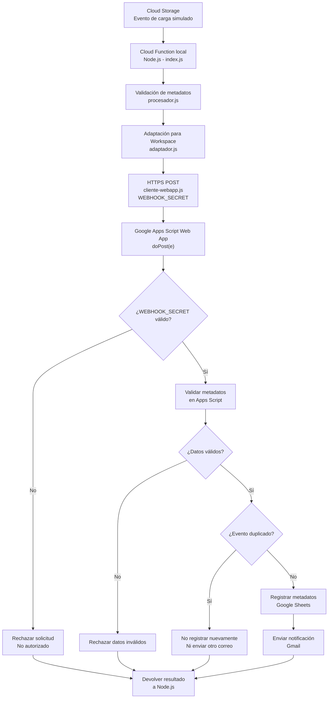

# Arquitectura de integración — Turing-IA Día 3

## 1. Objetivo

Integrar el procesamiento de eventos de Google Cloud Storage
con Google Workspace mediante una Cloud Function en Node.js
y una aplicación web de Google Apps Script.

## 2. Arquitectura implementada




## 3. Componentes

### Cloud Function - index.js

Punto de entrada del sistema.

Recibe eventos CloudEvent de tipo
`google.cloud.storage.object.v1.finalized`
y coordina el procesamiento.

Se ejecutó localmente mediante Functions Framework.

### Procesador - procesador.js

Valida:
- Tipo de evento.
- Nombre del archivo.
- Bucket de origen.
- Tamaño válido y no negativo.

### Adaptador - adaptador.js

Transforma los metadatos recibidos
al formato esperado por Google Apps Script.

### Cliente HTTP - cliente-webapp.js

Envía una solicitud POST a la aplicación web
de Google Apps Script.

Utiliza la URL configurada en
`WORKSPACE_WEBAPP_URL` y un secreto compartido
almacenado en `WEBHOOK_SECRET`.

### Google Apps Script - Codigo.gs

Recibe las solicitudes mediante `doPost(e)`.

Valida la autorización y los metadatos,
comprueba duplicados, registra datos
en Google Sheets y envía notificaciones Gmail.

## 4. Flujo de procesamiento

1. Se simula un evento de carga de archivo.
2. La Cloud Function recibe el CloudEvent.
3. Se validan los metadatos.
4. Se transforman al formato de Workspace.
5. El cliente realiza un POST al webhook.
6. Apps Script comprueba la autorización.
7. Se valida el contenido recibido.
8. Se consulta si el evento ya existe.
9. Se registra el archivo en Sheets.
10. Se envía una notificación por Gmail.
11. Se devuelve el resultado a Node.js.

## 5. Decisiones técnicas

- Node.js: reutilización del código desarrollado el Día 1.
- Functions Framework: pruebas locales sin habilitar facturación.
- Apps Script Web App: cumplimiento del endpoint solicitado.
- HTTP POST: transmisión estructurada de metadatos.
- Google Sheets: almacenamiento de registros de archivos.
- Gmail: notificaciones automáticas.
- Identificador de evento: prevención de registros duplicados.
- **Autenticación mediante WEBHOOK_SECRET:** permite comprobar que la solicitud contiene la credencial configurada antes de procesar los metadatos.
- **Validación en ambos extremos:** Node.js y Apps Script verifican la información para evitar procesar eventos inválidos.

## 6. Alcance

Se comprobó la integración real entre Node.js,
Apps Script Web App, Google Sheets y Gmail.

Cloud Storage y Cloud Functions no se desplegaron
en GCP debido a la falta de facturación habilitada.

Los eventos de Cloud Storage se simularon
localmente mediante PowerShell.
```
